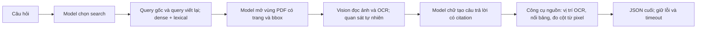

# Báo cáo Day 7 — Agentic RAG

**Phạm Trấn Quốc · 2A202604113 · L3B**

**Trạng thái hiện tại:** Phần cơ bản có đủ bằng chứng cho sáu nhóm rubric tối đa **85 điểm**; test nâng cao v3 đạt **28/30 = 93.33%**, vượt ngưỡng 90% để xét đủ **15 điểm bonus**. Hồ sơ đáp ứng các điều kiện cho mức tối đa **100 điểm** theo tự audit; điểm chính thức do giảng viên quyết định.

Tác giả đã xác nhận kiểm chứng toàn bộ nguồn ngày 16/11/2026, được ghi tại [biên bản](../../artifacts/source-verification.json). Không còn mục chờ tác giả xác nhận nguồn. Nhãn đầu ra ghi đúng vai trò Codex hỗ trợ đối chiếu câu trả lời với bản gốc; không gán việc tạo nhãn đó cho một người chấm bên ngoài. Xác nhận nguồn không sửa output hoặc nâng verdict model.

## Dữ liệu và benchmark

- Dependency code Day 6 lấy từ [repo public cá nhân](https://github.com/Quoosc/K5-L3B-DAY06-2A202604113-DataIngestion) tại commit `19a54c590f2c89198225592f2be9b1a926abdffd`. [Provenance](../../artifacts/day6-code-provenance.json) đối chiếu byte Git blob, file đang dùng và hash khóa của cả `embeddings.py`/`store.py`; runbook có lệnh lấy đúng code/model cho máy mới.
- Corpus là snapshot tài liệu CPython 3.12.10 của Day 6: tám nguồn, 40 đơn vị RST chuẩn hóa và 156 chunk cấu hình B. Trường `page` là **số đơn vị RST**, không phải số trang PDF. Nguồn, license, hash và đối chiếu payload nằm tại [manifest](../../artifacts/base/day6_manifest.json); [chunks](../../artifacts/base/chunks.jsonl) và hai file license được kèm theo.
- Embedding `intfloat/multilingual-e5-small`, revision `614241f622f53c4eeff9890bdc4f31cfecc418b3`, 384 chiều; query có prefix `query: ` đúng một lần. Qdrant local dùng cosine/exact. Đã so sánh **156/156 payload** và ID giữa collection `lab6_B` với export B; vector mẫu có norm `0.9999999443`. [Gói Qdrant công khai](../../artifacts/base/qdrant-snapshot.zip) được kiểm hash với freeze; không chứa model weights hoặc secret.
- Agent dùng Qwen2.5 7B Instruct Q4_K_M cục bộ qua llama.cpp b12406, GGUF SHA-256 `2bada8a7450677000f678be90653b85d364de7db25eb5ea54136ada5f3933730`, GPU RTX 3060 Laptop. Không gửi tài liệu sang API bên ngoài; chi phí API 0 USD, chưa tính điện và khấu hao máy.
- [Benchmark cơ bản](../../benchmarks/base/manifest.json): dev 20 câu có đáp án + 3 câu thiếu; test 5 + 2. Queries và gold tách file; model chỉ nhận queries, còn bước kiểm lock băm cả file gold để phát hiện thay đổi. Các nhóm evidence là AND, lựa chọn trong nhóm là OR. Mọi quote/nguồn/đơn vị và phương án thay thế đã qua validator. Câu thiếu dựa trên tên thực thể giả và scan toàn bộ text corpus; đây là bài kiểm tra abstention tương đối dễ, không đại diện cho mọi trường hợp thiếu bằng chứng.
- 20 câu answerable dev kế thừa Day 6 dev, còn test Day 7 viết mới và chọn sự kiện khác câu Day 6. Vì Day 6 đã dùng chính dev đó để chọn chunking B, kết quả dev có nguy cơ thiên lệch theo lựa chọn Day 6; test mới là phần đối chiếu độc lập hơn. Benchmark được Codex hỗ trợ soạn; tác giả đã xác nhận kiểm chứng toàn bộ nguồn tại biên bản hiện hành.

## Retrieval và thử nghiệm

Truy xuất ban đầu dùng query gốc, filter chỉ đến từ scope được cấp; mọi câu ở bộ này dùng scope rỗng. Agent được model chọn nội dung query của một lệnh `search`; trace lưu cả ranking query gốc lẫn query agent viết lại. Lexical là TF-IDF, token hóa NFC/casefold và giữ định danh có dấu chấm. Hybrid dùng RRF `Σ1/(60+rank)`, pool 10 mỗi nhánh và tie-break theo ID. Packer đếm token bằng tokenizer của server, giữ nguyên cả chunk hoặc bỏ nếu vượt 1.200 token.

| Cấu hình | Thay đổi | Split | Hit@1 | Evidence Hit@3 | Context Evidence Rate | p95 agent | Prompt token / API |
|---|---|---|---:|---:|---:|---:|---:|
| D0 | Dense, 3 ứng viên, rank pack | dev | 17/20 | 18/20 | 18/20 | 3.51 s | 37,727 / $0 |
| L0 | TF-IDF, 3 ứng viên | dev | 11/20 | 18/20 | 18/20 | 4.62 s | 37,683 / $0 |
| H0 | Dense + lexical RRF, 3 ứng viên | dev | 14/20 | 19/20 | 19/20 | 5.77 s | 37,812 / $0 |
| H1 | H0, cấp 6 ứng viên cho packer | dev | 14/20 | 19/20 | 19/20 | 7.04 s | 43,709 / $0 |
| H2 | H0, pack theo độ phủ từ query | dev | 14/20 | 19/20 | 19/20 | 5.91 s | 37,812 / $0 |
| H3 | H0, thêm một lượt model tự kiểm | dev | 14/20 | 19/20 | 19/20 | 11.34 s | 69,749 / $0 |
| D0 | Baseline đã khóa | test | 5/5 | 5/5 | 5/5 | 2.75 s | 11,424 / $0 |
| H0 | Cấu hình đã chọn | test | 4/5 | 5/5 | 5/5 | 3.14 s | 11,611 / $0 |

Hit@1/Hit@3 ở đây đo ranking query gốc; context được đo từ phần **thực gửi** ở lượt agent. Có thể có đủ evidence trong context nhưng model không trích hoặc trả lời lỗi. Kết quả test chỉ có năm câu answerable, không đủ để suy rộng. p95 dùng nearest-rank trên một lượt chạy tuần tự, model đã warm; thời gian agent không cộng lần retrieval query gốc dành riêng cho bảng so sánh. Không có retry và không đo điện năng.

Lựa chọn dùng thứ tự công bố trước: số câu grounded mức 2 + abstain đúng trên dev (lỗi bằng 0), rồi context, Hit@3, Hit@1, p95, chi phí và ID. Review AI bảo thủ cho D0/L0/H0/H1/H2 cùng `17/23`, H3 `16/23`; H0 thắng các tiêu chí tiếp theo. [Nhãn dev và phép chọn](../../artifacts/base/dev_review.json), [cấu hình gốc](../../configs/base-v1.json), [cấu hình bổ sung H3](../../configs/base.json), [freeze](../../artifacts/base/freeze.json) và [trace](../../artifacts/base/runs/) được giữ. Freeze ghi hash code, benchmark, E5, Qdrant và model; thời điểm khóa trước test.

Hai ví dụ lỗi dev và kết quả thử lại:

1. `b-dev-q24`: D0 lấy JSON/exceptions và từ chối nhầm; H0 đưa `library-stdtypes` đơn vị 1 lên hạng 1 và trả đúng điều kiện `__bool__`/`__len__`. Lượt agent lần lượt mất 2.89 s/1,727 input token và 4.89 s/1,702 input token. Đây là một ví dụ cải thiện retrieval, không bảo đảm H0 thắng trên mọi câu.
2. `b-dev-q01`: H0 trả đúng ý chính nhưng thêm ví dụ `str(s)`/`repr(s)` chưa có đủ định nghĩa của `s`; H1 giữ câu trả lời ngắn, đúng với đoạn được dẫn. H0/H1 tương ứng 5.77/4.11 s và 1,624/1,954 input token ở case này; tổng p95 của H1 lại cao hơn H0.
3. `b-dev-q04`: cả H0 và H3 đều trả “Yes” cho câu hỏi liệu handler lớp con bắt được exception lớp cha, dù [nguồn](https://raw.githubusercontent.com/python/cpython/v3.12.10/Doc/tutorial/errors.rst) nói điều ngược lại. H3 dùng 3,113 thay vì 1,695 input token và vẫn sai; tự kiểm cùng model không phải xác minh ngữ nghĩa đáng tin cậy.

Pilot đầu cũng phát hiện JSON sai và citation gộp; parser được sửa **trên dev**, giữ [trace pilot](../../artifacts/base/runs/pilot-h0-20261115/) và [pilot sau sửa](../../artifacts/base/runs/pilot2-h0-20261115/). Sau lượt dev chính, parser cho phép citation ở câu từ chối và chuẩn hóa ID trùng; các file `*-parser-v3.jsonl` đánh giá lại đúng output đã lưu, không gọi model lại và không xóa trace gốc. Citation ở câu từ chối chỉ mô tả đoạn đã xem, không tự chứng minh vắng thông tin toàn corpus.

## Agent và đánh giá test

Mỗi câu có một tool search do model gọi; có giới hạn, xác thực tham số, scope whitelist, registry nối alias `e1` với `chunk_id`/nguồn/offset, kiểm mọi marker và phân biệt `error` với `abstain`. Model nhìn nội dung retrieval như dữ liệu không đáng tin. [Probe an toàn tổng hợp](../../artifacts/base/safety-smoke-v2.jsonl) không làm theo chỉ dẫn giả nhưng từ chối nhầm câu có evidence; case không có kết quả từ chối và lỗi DB được báo `error`. Probe này không chứng minh hệ thống chống prompt injection tổng quát.

| Cấu hình / test | Tool use thành công | Grounded 0/1/2; trung bình /2 | Citation hỗ trợ | Câu trả lời có citation | Abstain đúng | Từ chối nhầm | Lỗi |
|---|---:|---|---:|---:|---:|---:|---:|
| D0 | 6/6 | 1/0/4; 1.6 | 4/9 | 4/4 | 2/2 | 0/5 | 1/7 |
| H0 | 6/6 | 2/0/3; 1.2 | 3/6 | 4/4 | 2/2 | 0/5 | 1/7 |

Mỗi mẫu số answerable vẫn là 5, kể cả lỗi. Context test được chấm `2` cho cả 5/5 câu ở cả hai cấu hình vì đoạn gold có trong context, kể cả câu cuối cùng lỗi. Các citation ở câu abstain không được coi là chứng minh vắng thông tin toàn tài liệu. [Review D0](../../artifacts/base/test-review-D0.jsonl), [review H0](../../artifacts/base/test-review-H0.jsonl), [trace test](../../artifacts/base/runs/base-test-20261115-v1/) và [tổng hợp](../../artifacts/base/test-review-summary-H0.json) cho phép mở từng nguồn. Nhãn đầu ra do Codex đối chiếu với bản gốc, công khai từng lý do và citation để người chấm kiểm tra.

- **Trả lời có evidence:** `b-test-03`, cả hai cấu hình dẫn `library-io`, đơn vị 4 và nói `IOBase.flush()` không làm gì trên stream chỉ đọc hoặc non-blocking; nguồn [CPython io](https://raw.githubusercontent.com/python/cpython/v3.12.10/Doc/library/io.rst).
- **Thiếu evidence:** `b-test-m01` yêu cầu ngày di chuyển của dự án giả Sapphire-Ledger; cả hai từ chối mà không đoán. Phạm vi scan và lý do nằm trong gold test.
- **Lỗi:** `b-test-01` cả hai có đủ context nhưng model trả JSON thiếu danh sách citation và câu bị cắt, nên tính lỗi; không sửa pipeline sau test. Ở `b-test-04`, H0 trả đúng sự kiện `list.index` nhưng citation trỏ đoạn `list.remove/pop`, nên grounded 0. D0 dẫn đúng đoạn. Vì vậy test không chứng minh H0 tốt hơn D0; theo nhãn hiện có D0 tốt hơn về grounded answer.

## Thử thách nâng cao v1 — lịch sử thí nghiệm

Nguồn là [Landsat 8 Data Users Handbook v5.0, USGS](https://www.usgs.gov/media/files/landsat-8-data-users-handbook), 114 trang PDF; SHA-256 `baf10fd32ebbc5d21a509869e2879f5ef23f0d275d8bddc01462ed02d18bc756`. Trang USGS ghi Public Domain; hình có nguồn bên thứ ba vẫn phải kiểm riêng. PDF và crop không được commit; nguồn và tọa độ cho phép tái tạo.

[Inventory](../../artifacts/advanced/page_inventory.jsonl) bao 114/114 trang ở mức **trích vùng ứng viên**: 744 text, 49 image, 28 vector-page và 31 table candidate. OCR cục bộ đã chạy trên cả 77 vùng image/vector; không có lỗi thực thi, nhưng tại mốc v1 có 10 vùng không nhận được chữ. Phần v3 bổ sung catalog/mô tả và áp dụng xác nhận nguồn của tác giả. [Provenance OCR](../../artifacts/advanced/ocr-provenance.json), [index v4](../../artifacts/advanced/search_manifest-v4.json) có 995 đoạn text/caption/OCR, và [QA trực quan](../../artifacts/advanced/qa_samples.md) lưu giới hạn của header bảng và nhãn hình. Số trang hoặc số vùng được quét không chứng minh mọi nội dung ảnh, bảng và biểu đồ đã được hiểu.

Sau các lượt dev đầu, Codex xem trực tiếp [10 vùng OCR rỗng](../../artifacts/advanced/empty-ocr-visual-review.md) và bổ sung mô tả định tính có nhãn AI vào [index v5](../../artifacts/advanced/search-manifest-v5-supplement.json); tại mốc v5, 67 vùng còn lại mới có OCR. V3 bổ sung mô tả nguồn và trạng thái kiểm chứng hiện hành. [Kiểm tra cấu trúc](../../artifacts/advanced/index-coverage-v5.json) ghi 114/114 trang và toàn bộ 852 vùng ứng viên đều có đoạn tìm kiếm; con số đó không chứng minh ý nghĩa hình đã được trích đúng. Ba truy vấn kiểm khói không thuộc benchmark tìm thấy đúng vùng trong top 5, thứ hạng 1/4/1 theo [trace](../../artifacts/advanced/visual-description-search-smoke.json), không chứng minh độ đúng câu trả lời. A4/A5 dùng index v5. Mã retrieval hiện đã sửa nội dung cảnh báo để phản ánh OCR/mô tả; [snapshot A1](../../artifacts/advanced/code-snapshots/a1/advanced_retrieval.py) giữ đúng hash phiên bản dùng trong trace A1.

[Benchmark nâng cao dự thảo](../../benchmarks/advanced/manifest.json) có dev 20+6 và test 24+6, đúng quota 6 bảng/5 ảnh/5 biểu đồ/4 multi-hop/4 text/6 thiếu ở test. Validator chỉ kiểm cấu trúc và locator; [audit từng gold test](../../artifacts/advanced/benchmark-test-source-review.md) ghi đối chiếu nguồn, không phải kết quả test agent. Các câu multi-hop chỉ dùng hai bảng; các câu thiếu evidence dựa trên tên giả. [Quét literal](../../artifacts/advanced/absence-audit-v1.summary.json) không tìm thấy 12 tên trong text 114 trang hoặc OCR 77 vùng, nhưng chưa kiểm được ngữ nghĩa toàn bộ hình. Đây là nhãn Codex hỗ trợ ở mốc v1; xác nhận toàn bộ nguồn của tác giả được ghi riêng trong biên bản hiện hành.

Pipeline thử nghiệm dùng Qwen2.5-VL 3B Q4 cục bộ, ảnh crop thực từ PDF và OCR chưa kiểm chứng. Model tạo **JSON action** `search`/`open_region`; đây không phải native tool calling của vision server. Bộ chọn có thể ưu tiên các nhãn bảng/hình được nêu trực tiếp trong câu hỏi, không đọc gold; tối đa hai vùng được mở và trace giữ ID, trang, bbox, hash crop, dữ liệu đưa vào model cùng phản hồi gốc. Thử nghiệm tìm đủ vùng của năm câu dev chọn trước tăng từ 3/5 ở index v1 lên 5/5 ở v3; [so sánh này](../../artifacts/advanced/dev-search-comparison.json) chỉ là kiểm tra retrieval nhỏ, không phải điểm trả lời.

| Cấu hình dev | Đạt / tổng | Bảng | Ảnh | Biểu đồ | Multi-hop | Text | Thiếu evidence | Lỗi hoặc thiếu |
|---|---:|---:|---:|---:|---:|---:|---:|---:|
| A0, vision và caption | 6/26 | 1/4 | 0/4 | 3/4 | 0/4 | 1/4 | 1/6 | 9 |
| A1, thêm OCR và schema | 8/26 | 2/4 | 1/4 | 4/4 | 0/4 | 0/4 | 1/6 | 6 |
| A2, hiệu đính chữ 7B trên trace A1 | 10/26 | 1/4 | 0/4 | 3/4 | 2/4 | 4/4 | 0/6 | 10 |
| A2, chuẩn hóa lại output đã lưu | 17/26 | 2/4 | 0/4 | 3/4 | 2/4 | 4/4 | 6/6 | 2 |
| A3, pilot phân nhánh theo loại nguồn | 21/26 | 4/4 | 1/4 | 4/4 | 2/4 | 4/4 | 6/6 | 1 |
| A4, thêm công cụ OCR trên trace dev mới | 25/26 | 4/4 | 3/4 | 4/4 | 4/4 | 4/4 | 6/6 | 0 |
| A5, chạy lại pipeline nhiều giai đoạn | 25/26 | 4/4 | 3/4 | 4/4 | 4/4 | 4/4 | 6/6 | 0 |

Các nhãn A1 được chấm bảo thủ: đáp án phải đúng và đầy đủ, mọi citation đi kèm phải hỗ trợ khẳng định, câu thiếu evidence phải thể hiện rõ việc từ chối. [Review A0](../../artifacts/advanced/dev-review-a0.jsonl), [review A1](../../artifacts/advanced/dev-review-a1.jsonl) và [tổng hợp A1](../../artifacts/advanced/dev-summary-a1.json) ghi từng câu. A1 bị gián đoạn sau câu 15, sau đó tiếp tục 11 câu còn lại bằng cùng model, cấu hình và code đã đối chiếu hash; câu lỗi trước đó không được chạy lại. Lần nối đầu bị `MemoryError` trước khi tạo trace và được ghi riêng. A0 có p95 khoảng 5,80 s, tổng 139.845 prompt token; A1 có 164.433 prompt token, nhưng thời gian bị ảnh hưởng bởi gián đoạn qua đêm nên không có p95 có ý nghĩa để so sánh. Cả hai dùng model cục bộ, API 0 USD; chưa tính điện và khấu hao.

A2 là **pilot offline trên dev**: model chữ Qwen2.5 7B nhận OCR/bảng đã mở cùng bản nháp vision A1, không nhận pixel hình hoặc gold. [Trace A2](../../artifacts/advanced/runs/advanced-dev-20261116-a2-refiner/) và [review](../../artifacts/advanced/dev-review-a2-refiner.jsonl) giữ output gốc; lượt chuẩn hóa sau đó dùng lại chính output ấy, không gọi model, ghi rõ mọi thay đổi trong [trace](../../artifacts/advanced/runs/advanced-dev-20261116-a2-parser-v2/) và [review](../../artifacts/advanced/dev-review-a2-parser-v2.jsonl). Quy tắc chỉ trình bày marker từ citation model đã khai báo cho một claim, hoặc dựng câu từ chối cố định khi model đã khai báo `abstain` nhưng câu rỗng; không biến khẳng định không được hỗ trợ thành đúng. Sáu câu thiếu evidence được chấm tạm theo audit hiện tại, vốn chưa bao phủ ngữ nghĩa toàn bộ hình. Vì A2 dùng lại evidence và bản nháp A1, 17/26 **không phải** kết quả pipeline mới chạy đầu-cuối hay kết quả test độc lập. Sau pilot này, A5 đã tích hợp lại các bước, chạy lại dev và tạo freeze composite cho hai model, projector, hiệu đính và chuẩn hóa.

Một [diagnostic](../../artifacts/advanced/text-only-dev-diagnostic.json) chỉ thử sáu lỗi dev đã biết bằng model chữ và OCR, không có ảnh gốc: nó đọc đúng 364 ở câu 002 và đọc được độ bất định ở câu 004, nhưng vẫn sai vị trí SCA ở 006/007, từ chối 008 và lỗi citation ở 016. Đây là mẫu chọn theo lỗi, không dùng để ước lượng độ chính xác tổng thể.

Một [diagnostic tọa độ OCR](../../artifacts/advanced/spatial-ocr-dev-diagnostic.json) bổ sung các hàng/cột và quan hệ trái/phải ước đoán, vẫn không đưa gold vào model. Trên ba lỗi hình đã chọn, model vẫn chọn sai band ở 006 và từ chối 007–008; riêng gợi ý vị trí không chứng minh được đường nối hay ý nghĩa của sơ đồ. Vì vậy không dùng kết quả này để nâng điểm A3.

Trong [pilot A3](../../artifacts/advanced/runs/advanced-dev-20261116-a3-policy-v2/), quy tắc được khai báo trước lượt pilot: câu nêu Figure dùng kết quả vision A1; câu nêu đúng một Table dùng model chữ đọc lại bảng/OCR mà không nhận bản nháp vision; các câu còn lại dùng kết quả A2 đã chuẩn hóa. [Review từng câu](../../artifacts/advanced/dev-review-a3-policy.jsonl) đạt 21/26: bốn câu bảng, bốn biểu đồ, hai multi-hop, bốn text, sáu từ chối và một hình. Ba câu hình còn sai (`006–008`), một multi-hop sai giá trị (`016`), một multi-hop giữ nguyên timeout (`013`). A3 được thiết kế từ lỗi dev và tái sử dụng trace A1/A2, chỉ gọi model mới cho bốn câu bảng, nên chưa phải thử nghiệm chạy đầu-cuối mới. Không dùng số này để tuyên bố điểm test; cần tích hợp, khóa cả pipeline và đo lại trước test.

A4 thêm hai công cụ có quy tắc công khai: tra vị trí OCR khi quan hệ trái/phải hoặc đầu cột là duy nhất; nối khoảng bước sóng–band trong OCR với hàng/cột performance của bảng khi tất cả kết quả là duy nhất. Chúng dựa trên câu hỏi và nguồn đã mở, không dùng gold, ghi tọa độ/ô và vẫn phải đối chiếu PDF; đây là quy tắc chuyên biệt cho những dạng câu hỏi tương ứng, không phải bảo đảm tổng quát. [A4](../../artifacts/advanced/dev-summary-a4-final.json) được tạo từ một lượt vision/text mới rồi bổ sung các công cụ trong quá trình phát triển. [A5](../../artifacts/advanced/dev-summary-a5-final.json) chạy lại chuỗi đã tích hợp trên toàn bộ dev: 25/26, lỗi còn lại là sơ đồ `adv-dev-008`; p95 cộng thời gian các giai đoạn là 9,36 s/câu, không tính khởi động server và thời gian chờ giữa hai giai đoạn. Có sáu lỗi định dạng ở lượt vision được ghi riêng và phục hồi ở bước sau, không có timeout và không có lỗi cuối; nhãn vẫn do Codex hỗ trợ.

[Freeze composite](../../artifacts/advanced/freeze-composite.json) ghi hash code, hai model, projector, OCR, index, benchmark và nhãn dev trước test. [Snapshot Qdrant v5](../../artifacts/advanced/qdrant-v5-snapshot.json) được đối chiếu 995/995 payload với export và không chứa ảnh PDF hay model weights. Bước finalization băm các file gold để kiểm lock nhưng không phân tích hoặc đưa nội dung gold vào model; dòng “gold is not read” trong manifest chưa mô tả chính xác việc đọc byte để băm. Lock không tự chứng minh toàn bộ tham số server hoặc projector đã nạp; cần đối chiếu command line/runtime. Hai server chạy tuần tự trên cùng máy; API 0 USD, chưa tính chi phí phần cứng/điện.

### Test nâng cao sau khi khóa

| Nhóm | Đạt / tổng |
|---|---:|
| Bảng | 6/6 |
| Ảnh/sơ đồ | 3/5 |
| Biểu đồ | 3/5 |
| Multi-hop | 4/4 |
| Text | 2/4 |
| Thiếu evidence | 6/6 |
| **Toàn bộ** | **24/30 = 80%** |

Kết quả trên là [review từng câu của Codex](../../artifacts/advanced/test-review-composite.jsonl), đối chiếu với [PDF](../../artifacts/advanced/benchmark-test-source-review.md), nguồn đã được tác giả xác nhận theo biên bản hiện hành; vai trò tạo nhãn đầu ra vẫn ghi là Codex hỗ trợ. [Trace vision](../../artifacts/advanced/runs/advanced-test-20261116-composite/), [trace cuối](../../artifacts/advanced/runs/advanced-test-20261116-final/) và [tổng hợp](../../artifacts/advanced/test-summary-composite.json) giữ đủ 30 câu. Không có lỗi cuối hoặc timeout; có **5 lỗi định dạng trung gian ở vision** được lưu và phục hồi ở giai đoạn sau. p95 cộng thời gian từng giai đoạn là 9,92 s/câu, không tính khởi động server hoặc chờ giữa các giai đoạn; tổng prompt token vision/text lần lượt 190.294/23.939, API 0 USD.

Sáu câu không đạt, không loại khỏi mẫu số: `009` không xác định đủ hai baffle; `011` trả Band 10 thay vì SCA-C/SCA02; `012` đọc cột NIR khoảng 360 thay vì khoảng 204; `016` nói marker màu đỏ nhưng thiếu hình vuông và trích thêm panel khác; `022` thiếu mức 256 của ảnh 8-bit; `024` từ chối dù nguồn có ngày 19/12/2014. Ở `024`, agent mở mục lục và caption trang 79 thay vì đoạn đúng trang 78: từ chối là hợp lý với context đã mở nhưng vẫn là lỗi truy xuất trên câu có đáp án. `013` trả 150 cho cột Cirrus, được tính đạt vì sai lệch 15 nhỏ hơn dung sai tuyệt đối 20 đã công bố trước. Sáu câu thiếu evidence được từ chối, nhưng audit absence vẫn có giới hạn đã nêu.

Các lỗi đáng chú ý: `adv-dev-002` đọc nhầm cột SNR 40 thay vì 364; `adv-dev-007` xác định nhầm SCA trong hình; `adv-dev-014/015` tìm được cả hai vùng và nêu đúng dữ kiện trong output gốc nhưng thiếu marker citation nên bị tính lỗi; `adv-dev-017` có nguồn trang 9 đúng nhưng trích thêm trang 2 không hỗ trợ; `adv-dev-023` đoán các số không có căn cứ cho cảnh giả. Đúng ID nguồn không tự bảo đảm câu trả lời được hỗ trợ.

Lượt test **v1 đạt 24/30 < 27/30**, nên riêng lượt này không đạt điều kiện cộng 15 điểm. Kết quả v1 được giữ nguyên; kết quả v2 và phiên bản hiện tại v3 nằm ở các phần bên dưới. Điểm này không được làm tròn để qua ngưỡng; ngoài ngưỡng còn phải có đủ hồ sơ nguồn/index, benchmark và tái lập. Các mục này được cập nhật ở phần v3.

## Phiên bản nâng cao v2 — A9

Toàn bộ 26 câu dev và 30 câu test v1 đã xem được chuyển thành **56 câu dev**, không tiếp tục gọi chúng là holdout độc lập. Bộ test mới được lập trước khi chạy model: **30 câu trên 23 trang nguồn**, đúng quota 6 bảng, 5 ảnh/sơ đồ, 5 biểu đồ, 4 multi-hop, 4 text và 6 thiếu evidence. Multi-hop dùng bốn cặp nguồn khác nhau; sáu câu thiếu evidence hỏi thuộc tính không được cung cấp của thực thể thật. [Manifest](../../benchmarks/advanced-v2/manifest.json), [protocol](../../benchmarks/advanced-v2/protocol.md), [kiểm tra split](../../artifacts/benchmark-validation.json) và [audit absence](../../artifacts/advanced/v2-absence-audit.json) lưu nguồn, locator, đơn vị, điều kiện, phép tính và dung sai. Một locator được sửa đúng đoạn CPF **trước mọi lượt chạy model trên test mới**, có biên bản trong manifest.

Các thay đổi có căn cứ từ dev: giữ query gốc để giảm mất thuật ngữ; gán caption theo vị trí để phân biệt nhiều hình trên cùng trang; điều hướng section; mở tối đa bốn vùng; đọc ảnh tự nhiên để tránh model nhỏ sao chép ví dụ JSON hoặc chọn từ chối trước khi đọc ảnh; phân biệt prompt bảng, text và định dạng quan sát hình. Bộ đo cột dùng pixel PDF gốc và fit tuyến tính các tick OCR, chỉ trả kết quả khi thang đo và cột màu là duy nhất; không có bảng đáp án hoặc số test viết cứng trong runtime.

A6 có nhiều từ chối sai; A7 sao chép câu ví dụ; A8 đọc ảnh tốt hơn nhưng prompt kết luận quá bảo thủ. [A6](../../artifacts/advanced/dev-a6-diagnostic.json), [A7](../../artifacts/advanced/dev-a7-diagnostic.json), [A8](../../artifacts/advanced/dev-a8-diagnostic.json), raw trace và snapshot code được giữ. Chỉ A9 được chọn sau review đủ dev. A9 tái dùng **giai đoạn vision A8 không thay đổi**; guard kiểm hash snapshot, AST toàn bộ perception/routing và các đầu vào liên quan. Không mô tả lượt dev này là vừa chạy mới cả hai giai đoạn. **Test v2 chạy mới cả vision lẫn text** dưới cùng một freeze; không được tái dùng dev hoặc chỉnh theo output test.

A9 dev: **52/56 = 92.86%**, bao gồm một lỗi hệ thống trong mẫu số. Bốn câu fail: citation JSON không khớp; nhầm hàng bước sóng Band 5; thiếu nhận diện baffle; nhầm nhãn instrument với số band. [Nhãn đủ 56 câu](../../artifacts/advanced/v2-dev-review.jsonl), [metrics](../../artifacts/advanced/v2-dev-summary.json) và [freeze trước test](../../artifacts/advanced/freeze-v2.json) giữ đầy đủ lý do, giá trị nguồn và audit citation. Đây là readiness dev, không thay thế điểm test.

Model vẫn là Qwen2.5-VL 3B Q4 và Qwen2.5 7B Q4 cục bộ; vision dùng crop 200 DPI, min/max image token 1024/2048, context 16384, GPU layers 99; text context 16384, GPU layers 22; temperature 0, không retry, timeout 180 giây. Hai server chạy tuần tự. [Cấu hình](../../configs/advanced-v2.json) và runtime attestation ghi executable SHA, model/projector SHA, command line thực, device, context và các tham số. Query/gold tách file; runtime chỉ băm byte gold để phát hiện thay đổi, không phân tích gold hoặc đưa gold vào model.

### Kết quả test độc lập v2

| Nhóm | Đạt / tổng |
|---|---:|
| Bảng | 3/6 |
| Ảnh/sơ đồ | 2/5 |
| Biểu đồ | 3/5 |
| Multi-hop | 0/4 |
| Text | 3/4 |
| Thiếu evidence | 6/6 |
| **Toàn bộ** | **17/30 = 56.67%** |

[Trace vision](../../artifacts/advanced/runs/advanced-v2-test-vision/), [trace cuối](../../artifacts/advanced/runs/advanced-v2-test-final/), [nhãn từng câu](../../artifacts/advanced/v2-test-review.jsonl) và [metrics đầy đủ](../../artifacts/advanced/v2-test-summary.json) có thể kiểm lại độc lập. Không loại hoặc thay câu; mọi lỗi, từ chối và timeout được giữ trong 30 câu. Citation được đối chiếu nội dung và vùng gốc, không chỉ kiểm ID.

Có 3 lỗi cuối; median 9.63 s, p95 20.91 s; 242,626 prompt token và 5,113 completion token. API 0 USD; không đo điện/khấu hao. Latency cộng thời gian từng stage, không cộng khởi động server hoặc chờ giữa stage. Metrics theo case và từng nhóm đều được lưu.

Các câu fail còn lại:

- `adv2-test-001`: The requested purpose and use are present, but an additional calibration-parameter claim incorrectly assigns Relative gain characterization to the integration-time-sweeps row. Correct parts do not excuse an unsupported extra claim.
- `adv2-test-002`: The model declares abstain on an answerable case despite stating the correct band-to-band assessment and OLI LOS parameters. The declared refusal remains a failure.
- `adv2-test-004`: The model refuses and demands actual timestamps although the question asks the meanings of HH1 and MM1, which the table explicitly defines.
- `adv2-test-008`: The finalizer produced citation markers inconsistent with the available source aliases; the recorded system error is retained.
- `adv2-test-010`: The finalizer produced inconsistent citation markers; the recorded system error is retained.
- `adv2-test-011`: The source tabs between Search Criteria and Results are Data Sets and Additional Criteria. Home and Save Criteria are toolbar items in another row.
- `adv2-test-014`: The answer conflates both axes and reports -50 to 5 degrees. The original horizontal range is -20 to +20 and vertical range -50 to +50 degrees.
- `adv2-test-016`: The answer is 50 versus the original trace near 53. Difference 3 exceeds the predeclared absolute tolerance 2.
- `adv2-test-017`: The answer confuses the 16-day repeat cycle with the 98.9-minute orbit duration, omits a supporting orbit citation and performs invalid dimensional arithmetic. Correct result is 98.9/50 ≈ 1.978 intervals.
- `adv2-test-018`: The CPF nn row starts at 00 while RLUT starts at 01. Claiming both start at 01 is wrong.
- `adv2-test-019`: The answer gives only bit 10 for Snow/Ice Confidence, omitting bit 9. The original merged field spans bits 9 and 10; LandsatLook bit 5 is correct.
- `adv2-test-020`: The vision controller selected invalid open_region handles and opened no sources. Finalization correctly retained a system error.
- `adv2-test-023`: The date-range condition is correct and supported by the page-48 region, but the additional page-47 quarterly-update passage does not support the acquisition-date condition and is an extraneous citation.

Kết quả v2 chưa đạt ít nhất 27/30, do đó chưa đủ điều kiện cộng bonus; không làm tròn hoặc sửa nhãn để qua ngưỡng.

## Phiên bản nâng cao hiện tại v3 — A12

**Kết quả chính thức của lượt test đã khóa: 28/30 = 93.33%**, cao hơn mức cần 27/30. Đây là điểm của toàn bộ holdout mới; không loại lỗi, không thay câu sai, không làm tròn để qua ngưỡng. [Metrics](../../artifacts/advanced/v3-test-summary.json), [trace đủ 30 câu](../../artifacts/advanced/runs/catalog-v3-test/traces.jsonl), [review từng câu](../../artifacts/advanced/v3-test-review.jsonl) và [freeze trước test](../../artifacts/advanced/freeze-catalog-v3.json) được nộp đầy đủ.

| Nhóm test | Đạt / tổng |
|---|---:|
| Bảng | 6/6 |
| Ảnh/sơ đồ | 5/5 |
| Biểu đồ | 5/5 |
| Multi-hop | 2/4 |
| Text | 4/4 |
| Thiếu evidence | 6/6 |
| **Toàn bộ** | **28/30 = 93.33%** |

### Sửa nguyên nhân từ những lượt trước

V1 giữ 24/30 và v2 giữ 17/30. Sau khi xem test v2, toàn bộ 86 câu cũ trở thành dev, không tiếp tục gọi là test độc lập. [Benchmark v3](../../benchmarks/advanced-v3/manifest.json) có 30 câu mới, đúng quota, thuộc tính/quan hệ mới và sáu câu thiếu hỏi thực thể thật. Catalog nguồn được xây trước benchmark v3; builder không đọc benchmark. Queries/gold tách riêng; runtime chỉ băm gold để kiểm lock, không phân tích đáp án hoặc vùng chuẩn cho model.

[Catalog v6](../../artifacts/advanced/catalog-v6/manifest.json) và [v7](../../artifacts/advanced/catalog-v7/manifest.json) giữ đủ 114 trang/852 vùng: 744 text, 49 ảnh, 31 bảng ứng viên, 28 trang vector; v7 có 941 chunk. Đã thêm header/ô bảng chuẩn hóa, đầy đủ hàng phổ Landsat 7/8, mô tả cả 49 ảnh, category/series biểu đồ và phép đo đường theo 12 mốc ngày nguồn. [Audit nguồn](../../artifacts/advanced/catalog-v7-source-audit.json) vượt 13/13 điều kiện về hash, độ phủ, locator, bbox, source chunk và provenance. [Snapshot Qdrant v7](../../artifacts/advanced/qdrant-v7-snapshot.json) đối chiếu **941/941 payload** với export. Một số ô gộp tự động còn khó phân tích; dữ liệu gốc/giới hạn được giữ, không khẳng định mọi bảng tự động đều đúng.

V3 dùng **mô tả ảnh/OCR và dữ liệu bảng nguồn**, rồi model chữ Qwen2.5 7B thực gọi native search; không gọi VLM trong từng câu v3. Mô tả được Codex hỗ trợ từ caption/OCR và kiểm hình; không gán thành một lượt vision inference mới hoặc một đợt review của người chấm bên ngoài. Cách xử lý này nằm trong các lựa chọn được ADVANCED.md cho phép. [Thiết kế và giới hạn](../../docs/CATALOG_V3.md) giải thích rõ nguồn, cách curation và routing.

Retriever giữ query gốc và query viết lại, kết hợp E5/Qdrant + TF-IDF/RRF, định tuyến nhãn Table/Figure hoặc heading từ chính câu hỏi. Caption ngắn không thay thế vùng bảng thật. Tối đa ba vùng, 10.000 ký tự/vùng và tổng 6.000 token; hàng khớp cụm từ câu hỏi được chép từ nguồn, không từ gold. Model nhận lại câu hỏi gốc để giữ đủ các phần so sánh/phép tính. JSON cuối chỉ chứa answer/citations; renderer chỉ gắn alias đã được model khai báo. Sentinel INSUFFICIENT_EVIDENCE thể hiện từ chối của model; lỗi vẫn là error.

Ngân sách một search thực thi: nếu có nhiều đề xuất thì chỉ thực thi đề xuất hợp lệ đầu, còn nếu không có đề xuất hợp lệ thì ghi rõ protocol recovery và tìm bằng query gốc. [Thống kê tool](../../artifacts/advanced/v3-tool-operations.json): dev có 81 native calls + 5 lần fallback được khai báo trên 86 câu; **test có 30/30 native search, 0 fallback**, mỗi câu đúng một search thực thi. Test context lớn nhất 1,654 token trong budget 6.000. Không ghi fallback thành native-call thành công.

### Chọn cấu hình trên dev và giữ độc lập của test

A10/A11 là pilot phát triển. A11 full-dev dừng ở 59 câu do giả định cứng về một native proposal; trace và [diagnostic](../../artifacts/advanced/dev-a11-diagnostic.json) được giữ, không dùng làm điểm qualifying dev. A12 chạy mới đủ 86 câu với controller recovery đã công bố. [Review dev](../../artifacts/advanced/v3-dev-review.jsonl) đạt **78/86 = 90,70%**, không có lỗi hệ thống; tám fail gồm thiếu Kelvin, đọc nhầm SCA/band, nhầm category biểu đồ, từ chối sai và thiếu/sai vùng citation. Một câu kế thừa hỏi sai số mục orbital period có [errata](../../artifacts/advanced/benchmark-errata.json); không sửa gold hoặc nâng verdict để làm đẹp điểm.

Sau review dev, freeze kiểm byte code, cấu hình, catalog, benchmark, E5, PDF, model và DB, đồng thời kiểm executable SHA/command line runtime thực. Chỉ sau đó chạy mới toàn bộ 30 câu test. Không chỉnh pipeline theo output test v3. [Cấu hình A12](../../configs/catalog-v3.json): Qwen2.5 7B Q4, llama.cpp b12406, context 16.384, Vulkan1, GPU layers 22, threads 8, parallel 1, temperature 0, max output 360, không retry, timeout 180 giây.

### Hai câu test chưa đạt và giới hạn còn lại

- **adv3-test-018:** đúng ý 08 là Landsat 8 và có hai nguồn đúng, nhưng liệt kê mọi trường của tên file thay vì chỉ rõ **NN** là trường vệ tinh trong Table 3-5 và **SS** trong Table 4-1. Tính fail bảo thủ vì chưa xác định đúng trường được hỏi.
- **adv3-test-020:** model từ chối. Bộ chọn vùng lấy phần giới thiệu đầu Section 2.2/2.3, bỏ đoạn trang 19/22 chứa **14 SCA của OLI** và **3 SCA của TIRS**; vì vậy không có đủ evidence trong context để tính **14 − 3 = 11**. Tính fail trên câu answerable; không đổi thành đúng vì việc từ chối phù hợp với context thiếu.

Không còn lỗi hệ thống trong test v3, nhưng multi-hop chỉ **2/4** và là hạn chế rõ nhất. Sáu câu thiếu đều từ chối đúng; điều này chỉ chứng minh sáu trường hợp đã chọn. Benchmark nhỏ, do cùng người/agent xây và review, cùng một PDF đã được curation, nên 93,33% không phải ước lượng tổng quát cho tài liệu mới. Có thể cải thiện section retrieval và lựa chọn trường ở phiên bản tương lai; nếu dùng hai lỗi này để chỉnh thì cần một holdout mới hoàn toàn trước khi báo số đo độc lập tiếp theo.

Median **4.65 s**, p95 **10.80 s**; 38,970 prompt token, 2,277 completion token; **API 0 USD**. Latency gồm runtime từng câu, không cộng chuẩn bị catalog, khởi động server hoặc chờ giữa lượt. Chưa đo điện/khấu hao và chi phí thời gian curation; không so tốc độ này như cùng workload với vision pipeline v2.

## Đối chiếu đầy đủ phần cơ bản — tối đa 85 điểm

| Nhóm rubric | Điểm tối đa | Bằng chứng đã hoàn thành |
|---|---:|---|
| Dữ liệu và benchmark | 13 = 6 + 7 | Day 6/E5/Qdrant thật, 156 payload khớp, nguồn/license; dev 20+3 và test 5+2, query/gold tách riêng, evidence và absence rationale. |
| Retrieval | 17 = 10 + 7 | Dense, TF-IDF, RRF cùng corpus/dev; ranking query gốc, score/rank/nguồn, scope/filter, cấu hình và xử lý lỗi. |
| Agent và context | 17 = 9 + 8 | Qwen 7B thực gọi native search; context token budget, quyết định pack, registry citation, abstain và trạng thái lỗi riêng. |
| Đánh giá | 17 = 9 + 8 | Hit@1/Hit@3/context; chấm 0/1/2 đủ năm answerable cho cả D0/H0, citation support, abstention/false abstention, phân bố tool use và lỗi đúng mẫu số. |
| Thử nghiệm và cải thiện | 13 = 5 + 5 + 3 | H1/H2 và H3 có đối chứng; ít nhất hai lỗi dev trước/sau; chọn H0 trên dev, freeze trước cùng test bảy câu; so chất lượng, latency, token và chi phí. |
| Tái lập và báo cáo | 8 = 5 + 3 | Dependency/model/source pin, snapshot hợp lệ, runbook từ dev đến freeze/test/review/score; checkout sạch và báo cáo đúng tên, kết luận và giới hạn trung thực. |
| **Tổng phạm vi bằng chứng** | **85** | [Audit máy kiểm được](../../artifacts/submission-audit.json); đây là audit điều kiện/bằng chứng, không phải điểm giảng viên đã cấp. |

[Metrics cơ bản bổ sung](../../artifacts/base/submission-metrics.json) ghi phân bố số lần search cho mọi câu, riêng câu thành công và câu lỗi. Mỗi cấu hình test có bảy câu gọi một search, trong đó sáu thành công và một lỗi. Không đổi lựa chọn H0 sau khi thấy D0 grounded tốt hơn trên test. Rubric cơ bản không có ngưỡng chất lượng tuyệt đối; vẫn giữ điểm thấp và phân tích hạn chế thay vì sửa test.

## Tái lập, nguồn và trạng thái nộp

Sau review bổ sung, hướng dẫn khởi động server cơ bản đã được viết đầy đủ trong runbook: context 4096, port 8085, model alias, GPU layers, threads/parallel và `--jinja`. Hàm chờ kiểm `/health` cùng alias/context; các block dừng process và chuyển sang V3 context 16384 được chạy kiểm thực tế trong [biên bản](../../artifacts/runbook-server-check.json). Bổ sung này hoàn thiện tài liệu tái lập; code, benchmark, freeze và điểm test 28/30 giữ nguyên.

[Runbook đầy đủ](../../docs/REPRODUCE.md) gồm prerequisite, phục hồi Qdrant, model/hash, dev, review, freeze, test và score. [Checkout sạch](../../artifacts/clean-checkout-check.json) vượt qua **10 kiểm tra** cho phiên bản cuối: 61 unit test, validator cả tám split, tái tổng hợp trace cơ bản và đầy đủ test v3, checksum core/catalog/model/PDF/DB sau Git checkout, và một lượt native-tool model dev smoke. Đây là checkout nguồn sạch trên cùng máy, dùng môi trường dependency đã pin và model bên ngoài; không tự nhận đã thử trên máy khác hoặc venv mới hoàn toàn.

Smoke đầu cho câu dev dài tái hiện JSON bị cắt; [biên bản](../../artifacts/clean-checkout-first-attempt.json) và [trace](../../artifacts/clean-checkout-first-attempt-trace.jsonl) được giữ. Smoke cơ bản lịch sử kiểm tra transport/structure trả về abstain có cấu trúc; không tính đó là một câu trả lời đúng hoặc thay kết quả benchmark. `.gitattributes` bảo toàn byte của đầu vào đã băm khi checkout qua Windows/Linux; Git chấp nhận CRLF của hiện vật đã khóa và hard line-break Markdown.

Nguồn đã được tác giả xác nhận; [audit index hiện tại](../../artifacts/advanced/index-audit-author-confirmed.json) bao phủ 114 trang/852 vùng. Các trạng thái PARTIAL/PROVISIONAL trong manifest ban đầu là lịch sử, không phải một yêu cầu tác giả xác nhận lại. OCR/bảng tự động và model vẫn có thể sai; source-region trace cho phép kiểm từng kết luận. PDF/crop và weights không nằm trong Git; snapshot chỉ có dữ liệu được phép chia sẻ, kèm nguồn/license và cách tái tạo.

[Repo cá nhân](https://github.com/Quoosc/K5-L3B-Day07-PhamTranQuoc-2A202604113-RetrievalContext) đã được [kiểm tra public bằng truy cập không đăng nhập](../../artifacts/repository-access.json). File nộp được đưa vào Git; không đưa `.local`, venv, weights, secret hoặc dữ liệu mật vào repo. Việc xóa `RULES.md` đã có trước công việc này được giữ riêng, không gộp vào thay đổi bài lab.
